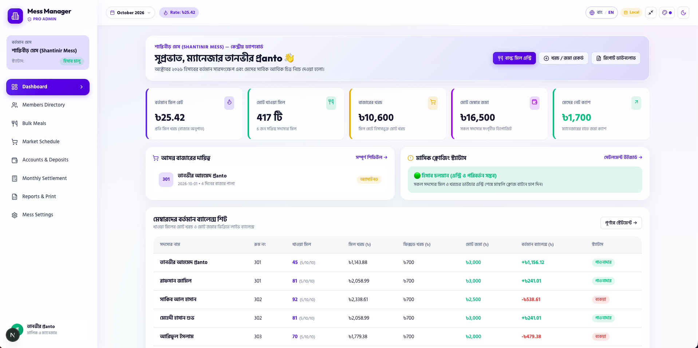

# Mess Management System — Documentation Workspace



স্বাগতম! এই ওয়ার্কস্পেসটিতে মেস ম্যানেজমেন্ট সিস্টেমের জন্য **ওয়েবসাইট (Web Portal)** এবং **মোবাইল অ্যাপস (Mobile App)**-এর সমস্ত ইনস্ট্রাকশন ও আর্কিটেকচার আলাদা দুটি ফোল্ডারে সুবিন্যস্ত করা হয়েছে:

---

## 📁 ফোল্ডার ডিরেক্টরি

### 1. 🌐 [`Mess Website`](file:///Users/pranto/Desktop/Mass%20Manager/Mess_Management_Documentation/Mess%20Website)

মেসের সেন্ট্রাল কন্ট্রোল ও অ্যাডমিন প্যানেল (Next.js App Router, Tailwind CSS, Supabase Backend & Database Schema)।

- [`Mess Website/README_WEBSITE_BN.md`](file:///Users/pranto/Desktop/Mass%20Manager/Mess_Management_Documentation/Mess%20Website/README_WEBSITE_BN.md)
- [`Mess Website/01_WEB_ARCHITECTURE_BN.md`](file:///Users/pranto/Desktop/Mass%20Manager/Mess_Management_Documentation/Mess%20Website/01_WEB_ARCHITECTURE_BN.md)
- [`Mess Website/02_DATABASE_AND_BACKEND_BN.md`](file:///Users/pranto/Desktop/Mass%20Manager/Mess_Management_Documentation/Mess%20Website/02_DATABASE_AND_BACKEND_BN.md)
- [`Mess Website/03_WEB_SECURITY_RLS_BN.md`](file:///Users/pranto/Desktop/Mass%20Manager/Mess_Management_Documentation/Mess%20Website/03_WEB_SECURITY_RLS_BN.md)
- [`Mess Website/04_WEB_UI_UX_LIQUID_GLASS_BN.md`](file:///Users/pranto/Desktop/Mass%20Manager/Mess_Management_Documentation/Mess%20Website/04_WEB_UI_UX_LIQUID_GLASS_BN.md)
- [`Mess Website/05_WEB_ROADMAP_BN.md`](file:///Users/pranto/Desktop/Mass%20Manager/Mess_Management_Documentation/Mess%20Website/05_WEB_ROADMAP_BN.md)
- [`Mess Website/06_WEB_TEST_PLAN_BN.md`](file:///Users/pranto/Desktop/Mass%20Manager/Mess_Management_Documentation/Mess%20Website/06_WEB_TEST_PLAN_BN.md)
- [`Mess Website/supabase_schema.sql`](file:///Users/pranto/Desktop/Mass%20Manager/Mess_Management_Documentation/Mess%20Website/supabase_schema.sql)

---

### 2. 📱 [`Mess Apps`](file:///Users/pranto/Desktop/Mass%20Manager/Mess_Management_Documentation/Mess%20Apps)

মেসের সাধারণ সদস্য ও মেম্বারদের জন্য মোবাইল অ্যাপ্লিকেশন (Expo, React Native, 5-Tab Navigation, Offline Support)।

- [`Mess Apps/README_APPS_BN.md`](file:///Users/pranto/Desktop/Mass%20Manager/Mess_Management_Documentation/Mess%20Apps/README_APPS_BN.md)
- [`Mess Apps/01_MOBILE_ARCHITECTURE_BN.md`](file:///Users/pranto/Desktop/Mass%20Manager/Mess_Management_Documentation/Mess%20Apps/01_MOBILE_ARCHITECTURE_BN.md)
- [`Mess Apps/02_MOBILE_SUPABASE_INTEGRATION_BN.md`](file:///Users/pranto/Desktop/Mass%20Manager/Mess_Management_Documentation/Mess%20Apps/02_MOBILE_SUPABASE_INTEGRATION_BN.md)
- [`Mess Apps/03_MOBILE_SECURITY_AND_ENV_BN.md`](file:///Users/pranto/Desktop/Mass%20Manager/Mess_Management_Documentation/Mess%20Apps/03_MOBILE_SECURITY_AND_ENV_BN.md)
- [`Mess Apps/04_MOBILE_UI_UX_GUIDE_BN.md`](file:///Users/pranto/Desktop/Mass%20Manager/Mess_Management_Documentation/Mess%20Apps/04_MOBILE_UI_UX_GUIDE_BN.md)
- [`Mess Apps/05_MOBILE_ROADMAP_BN.md`](file:///Users/pranto/Desktop/Mass%20Manager/Mess_Management_Documentation/Mess%20Apps/05_MOBILE_ROADMAP_BN.md)
- [`Mess Apps/06_MOBILE_TEST_PLAN_BN.md`](file:///Users/pranto/Desktop/Mass%20Manager/Mess_Management_Documentation/Mess%20Apps/06_MOBILE_TEST_PLAN_BN.md)
- [`Mess Apps/DATABASE_CONTRACT_BN.md`](file:///Users/pranto/Desktop/Mass%20Manager/Mess_Management_Documentation/Mess%20Apps/DATABASE_CONTRACT_BN.md)

---

### 3. 📦 `Original_Core_Documentation/`

মূল কম্বাইন্ড ডকুমেন্টস ও ব্লুপ্রিন্ট ব্যাকআপ হিসেবে সংরক্ষিত রয়েছে।

### 🚀 Run Front End (ওয়েবসাইট চালু করার নিয়ম)

```bash
cd "Mess Website"
npm install
npm run dev
```

ব্রাউজারে ভিজিট করুন: [http://localhost:3000](http://localhost:3000)
